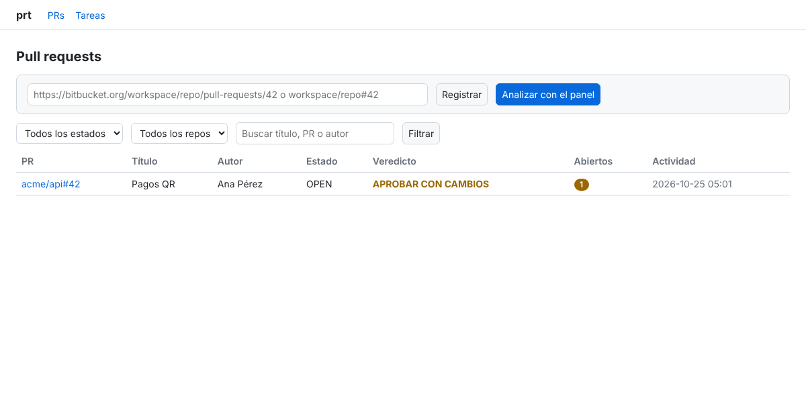
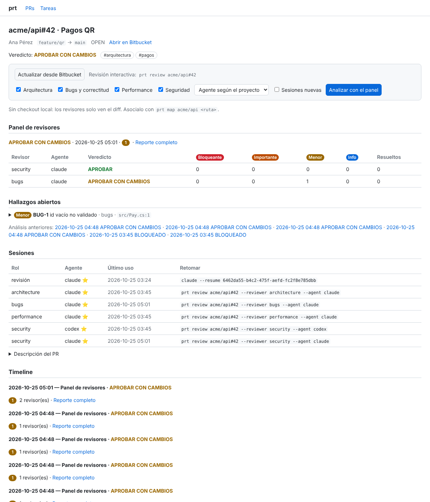
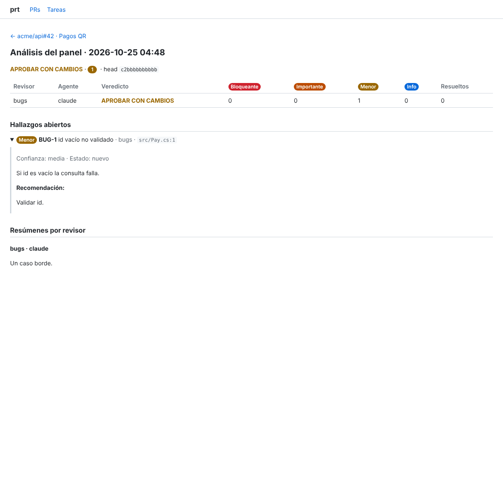
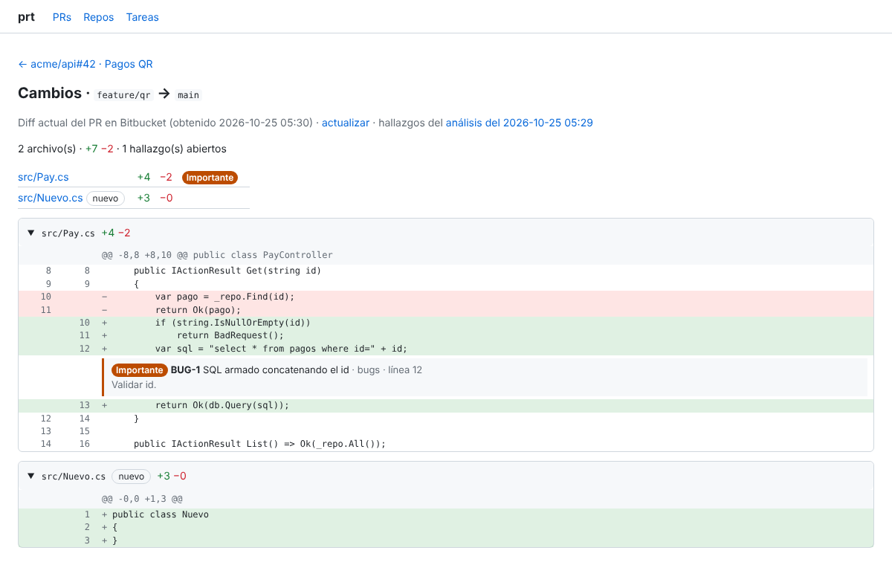
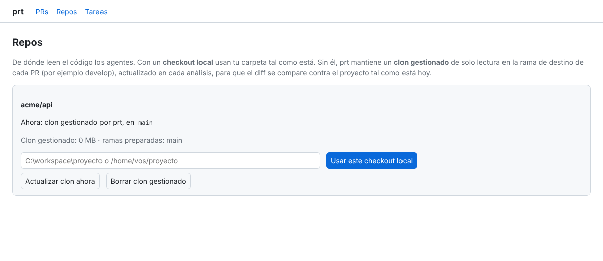
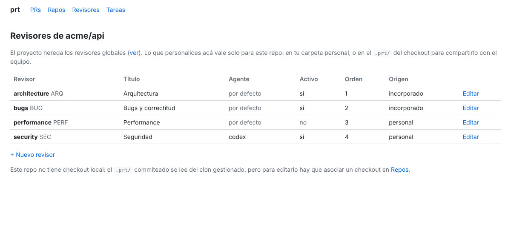
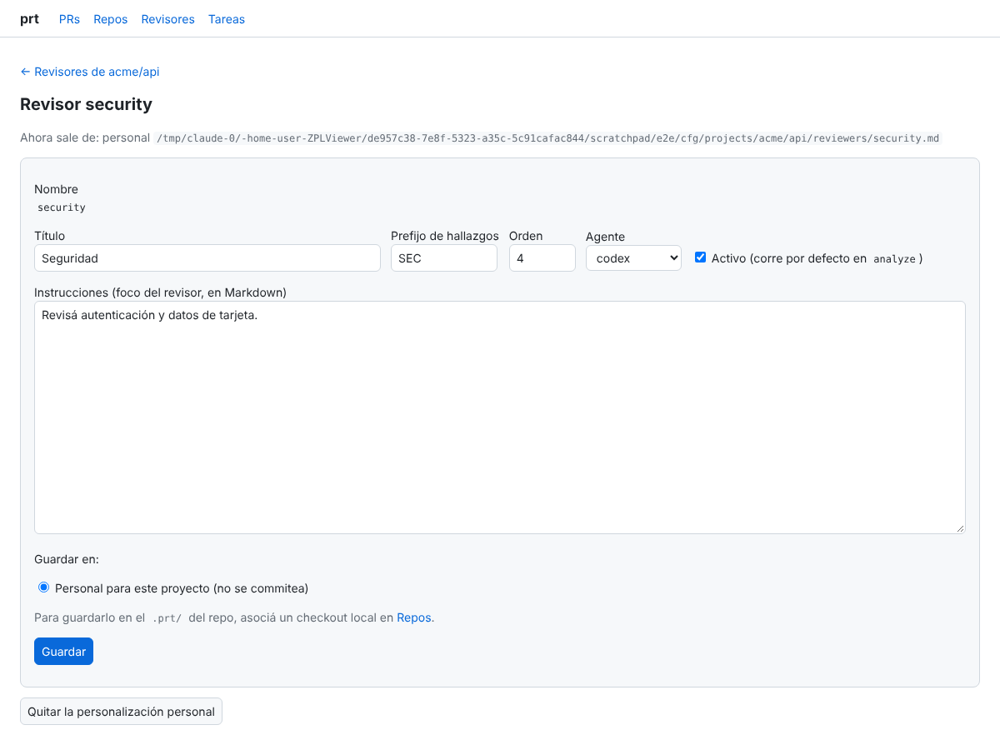

# prt — PR Review Tracker

Herramienta de terminal para darle trazabilidad a las revisiones de Pull Requests de **Bitbucket Cloud** hechas con agentes CLI (**Claude Code**, **Codex CLI**, **opencode**).

- Cada PR queda asociado a la **sesión del agente** con la que se revisó: `prt review <pr>` retoma siempre la misma sesión, con todo su contexto.
- Cada vez que abrís la sesión se registra una **ronda**; al salir, el agente escribe un **memo** (hallazgos, riesgos de arquitectura, impacto de negocio, pendientes, veredicto) en la misma sesión, y podés sumar tu nota.
- Si el PR recibió commits desde la última revisión, `prt` lo detecta y le pide al agente que revise solo lo nuevo.
- **Panel de revisores** (`prt analyze`): arquitectura, bugs, performance y seguridad corren en paralelo, cada uno en su propia sesión, y responden con un **formato de reporte estándar** que es el mismo sin importar el proveedor de IA. Los revisores, el estándar y el contexto se configuran **por proyecto**. Ver [docs/REVIEW_STANDARD.md](docs/REVIEW_STANDARD.md).
- **Comentarios en Bitbucket desde la web**: en el diff del PR se ven los comentarios inline existentes y se puede comentar cualquier línea, responder hilos o publicar un hallazgo del panel con el texto listo para editar. Los revisores leen esos comentarios en la próxima pasada.
- **Revisión conjunta** (`prt group`): los PRs de varios repos que implementan una misma feature se agrupan y se revisan juntos. Cada revisor ve todos los PRs en una sola sesión, un revisor de **coordinación** busca contratos rotos y problemas de despliegue entre repos, y cada PR recibe su parte de los hallazgos.
- Todo se guarda en una base SQLite local y se **exporta a Obsidian**: una nota por PR con frontmatter, sesiones, panel, pendientes y timeline, un reporte por cada análisis y un índice.

## Instalación

Requiere el SDK de .NET 10 (incluye el runtime de ASP.NET Core que usa el panel web).

```bash
dotnet pack src/Prt.Cli -c Release
dotnet tool install -g --add-source ./nupkg PrReviewTracker
```

Para actualizar: `dotnet tool update -g --add-source ./nupkg PrReviewTracker` (subí `<Version>` en `src/Prt.Cli/Prt.Cli.csproj`).

## Configuración

```bash
prt init                       # interactivo: vault, carpeta, agente por defecto, credenciales
prt map acme/payments ~/src/payments   # checkout local donde corre el agente para ese repo
```

### De dónde leen el código los agentes

1. **Checkout local** asociado al repo, con `prt map <ws/repo> <ruta>` o desde la página **Repos** de la web. Los agentes usan tu carpeta tal como está. Si corrés `prt review`/`prt analyze` dentro de un clon del repo (detectado por el remoto de Bitbucket, también desde subcarpetas o worktrees), prt propone asociarlo.
2. **Clon gestionado por prt** (por defecto, cuando no hay checkout). prt clona el repo una vez con tu API token, en modo solo lectura: es un clon parcial que baja el historial sin el contenido de los archivos. En cada análisis lo deja en la **punta de la rama de destino del PR** (por ejemplo `develop`), así el diff se compara contra el proyecto tal como está hoy. También trae la rama del PR, para que los agentes puedan usar `git diff origin/develop...origin/feature`.
3. **Solo el diff**, si desactivás los clones (`"managedClones": false`) o el clon falla.

```bash
prt map acme/payments --managed   # volver al clon gestionado
prt repos                         # de dónde lee cada repo y cuánto ocupan los clones
prt repos clean [acme/payments]   # borrar clones gestionados (se recrean en el próximo análisis)
```

Detalles del clon gestionado:

- **Ubicación**: `<datos>/repos/<ws>/<repo>/`, con un worktree por rama de destino.
- **Credenciales**: el token viaja a git por variables de entorno y solo hacia bitbucket.org. Nunca queda en `.git/config`, ni en la línea de comandos, ni al alcance de los agentes.
- **Usuario de git**: con un API token de Atlassian es `x-bitbucket-api-token-auth`; con una app password, tu usuario de Bitbucket. Se puede cambiar con `bitbucket.gitUsername` en el config. El token necesita permiso de lectura de repositorios.
- **Requisito**: tener `git` instalado.

Bitbucket Cloud: creá un **API token** de Atlassian con permiso de lectura de pull requests y repositorios, y usá tu email de Atlassian como usuario (también funcionan usuario + app password). Las variables `PRT_BB_USER` y `PRT_BB_TOKEN` tienen prioridad sobre el config.

| Qué | Dónde |
|---|---|
| Config | `~/.config/prt/config.json` (Windows: `%APPDATA%\prt\config.json`), permisos 600 |
| Base de datos | `~/.local/share/prt/prt.db` (Windows: `%LOCALAPPDATA%\prt\prt.db`) |
| Overrides | `PRT_CONFIG_DIR`, `PRT_DATA_DIR` |

## Uso

```bash
prt review https://bitbucket.org/acme/payments/pull-requests/42   # o acme/payments#42
prt review acme/payments#42 --agent codex      # otra sesión, con otro agente
prt review acme/payments#42 --new              # forzar sesión nueva
prt review acme/payments#42 -p "Enfocate en la migración"
prt analyze acme/payments#42                   # panel completo de revisores, en paralelo
prt analyze acme/payments#42 -r security,bugs  # solo algunos revisores
prt analyze acme/payments#42 --agent codex     # todos los revisores con un mismo agente
prt report acme/payments#42 [--markdown|--json]
prt review acme/payments#42 --reviewer security   # abrir la sesión del revisor para discutir sus hallazgos
prt reviewers init acme/payments               # copiar estándares y revisores a <checkout>/.prt para personalizarlos
prt reviewers list acme/payments               # qué revisores aplican y de dónde sale cada uno
prt resume                                     # elegir de la lista de PRs registrados
prt list --state OPEN
prt show acme/payments#42                      # sesiones, rondas y memos
prt memo acme/payments#42 -m "Ok de negocio con Producto" --kind decision
prt link acme/payments#42 --agent claude --session <id>   # asociar una sesión que ya existía
prt tag acme/payments#42 arquitectura pagos
prt sync                                       # refrescar PRs abiertos desde Bitbucket
prt export                                     # regenerar todas las notas
prt repair-text [pr] [--dry-run]               # reparar acentos rotos (UTF-8 leído como CP850) ya guardados
```

`prt review` sin `--agent` usa el agente de la última sesión del PR (para retomar la misma), o el agente por defecto si el PR es nuevo.

### Flujo de una ronda

1. Lee el PR y sus commits de Bitbucket (si no hay red y el PR ya está registrado, sigue con los datos guardados).
2. Si no hay sesión para ese agente: abre una nueva con el prompt inicial (URL, ramas, descripción, foco de revisión). Si hay: la retoma y, si hay commits nuevos, ofrece enviar el prompt de re-revisión.
3. Trabajás con el agente normalmente. Al salir:
4. Pide el memo al agente en modo headless **dentro de la misma sesión** y lo guarda; extrae el veredicto y los pendientes.
5. Pregunta si querés agregar una nota propia (`$VISUAL`/`$EDITOR`, o en línea terminando con `.`).
6. Exporta la nota del PR y el índice al vault.

## Panel web

```bash
prt web start [--port 5178] [--open] [--sleep-after 10]   # en segundo plano
prt web status                                           # URL, memoria, si está en reposo, tareas en curso
prt web stop                                             # lo apaga
prt web serve                                            # en primer plano (Ctrl+C para salir)
```

Desde el navegador (`http://127.0.0.1:5178`) podés:

- ver la lista de PRs con filtros por estado y repo, y búsqueda;
- abrir el detalle de un PR: sesiones con el comando para retomarlas, el último análisis del panel (hallazgos, preguntas), análisis anteriores, timeline y descripción;
- abrir el reporte completo de cada análisis;
- **ver el diff del PR** con cada hallazgo del panel debajo de la línea a la que apunta (los que no tienen línea dentro del diff aparecen arriba del archivo). Hay dos vistas: el diff actual, pedido a Bitbucket y guardado en caché unos minutos (o el del último análisis si no hay conexión), y el diff exacto que revisó cada análisis. Los archivos grandes empiezan plegados y los diffs enormes muestran un link a Bitbucket;
- registrar notas, decisiones y tags (se exportan a Obsidian igual que desde la consola);
- registrar un PR nuevo, actualizarlo desde Bitbucket o lanzar `analyze` eligiendo revisores y agente. Corren como tareas en segundo plano; la página se refresca sola mientras corren.

La revisión interactiva (`prt review`) sigue en la terminal, porque necesita una consola.

**Consumo mínimo**:

- Kestrel en modo *slim* (sin MVC ni Razor), páginas generadas en el servidor sin JavaScript, con el CSS embebido.
- Una conexión a SQLite por pedido y GC de estación sin hilo de fondo (`ConserveMemory`).
- En reposo usa unos 12 MB de memoria propia; el resto que muestra el sistema son librerías del runtime compartidas.
- **Reposo**: tras `--sleep-after` minutos sin pedidos (10 por defecto; 0 lo desactiva) libera memoria y conexiones y no ejecuta nada hasta el próximo pedido, que lo despierta solo. No entra en reposo mientras hay un análisis en curso.

**Seguridad**:

- Escucha solo en `127.0.0.1` y rechaza pedidos con otro `Host` (protección contra DNS rebinding).
- Los formularios llevan un token anti-CSRF.
- El Markdown de los agentes se muestra con el HTML desactivado y una Content-Security-Policy estricta.
- `prt web stop` usa un token que se guarda en `web.json`, en la carpeta de datos, con permisos 600.

| Lista de PRs | Detalle de un PR | Reporte de un análisis |
|---|---|---|
|  |  |  |

Diff del PR con los hallazgos sobre el código:



La página **Repos** permite asociar un checkout local, volver al clon gestionado, actualizarlo o borrarlo:



## Panel de revisores

`prt analyze <pr>`:

1. Refresca el PR, descarga el diff de Bitbucket y arma una carpeta de contexto por corrida (diff, descripción y commits, contexto del proyecto y hallazgos anteriores de cada revisor).
2. Resuelve el perfil del proyecto (revisores, estándar, contexto, agente por revisor) por capas: incorporado → `~/.config/prt` → `<checkout>/.prt` → `~/.config/prt/projects/<ws>/<repo>`.
3. Lanza cada revisor en modo headless y solo lectura, en paralelo (`maxParallel`). La primera vez abre una sesión por revisor; las siguientes la **retoman** con los commits nuevos y los hallazgos anteriores, para que marque cada uno como resuelto o abierto.
4. Valida y normaliza cada respuesta (severidades, veredicto coherente, ids). Si alguna no cumple el formato, pide una corrección en la misma sesión.
5. Consolida el veredicto (el peor), lo guarda y exporta el reporte a Obsidian.

El estándar completo (severidades, veredicto, contrato JSON, estructura del reporte y personalización) está en [docs/REVIEW_STANDARD.md](docs/REVIEW_STANDARD.md).

## Comentar el PR desde la web

En **Ver diff** de un PR:

- Los comentarios que ya tiene el PR en Bitbucket aparecen bajo su línea, con sus respuestas. Los de líneas que ya no están en el diff van arriba del archivo, y los generales en un desplegable.
- Pasá el mouse por una línea y tocá **+** para comentarla. Las líneas borradas se comentan del lado anterior. «comentar el archivo» deja un comentario sobre el archivo, y «Responder» contesta un hilo.
- Cada hallazgo del panel tiene **Comentar en Bitbucket**, en el diff y en la página del PR. Abre el formulario sobre su línea (o sobre el archivo, si la línea no está en el diff) con el texto armado: id, título, severidad, descripción y recomendación. Después queda marcado como *✓ comentado*.
- Lo que publicás queda también en la timeline del PR y en su nota de Obsidian.

Para comentar, el token necesita **permiso de escritura en pull requests**: con un API token de Atlassian, el scope `write:pullrequest`; con una app password, *Pull requests: Write*. Para leer alcanza el permiso de lectura de siempre. Si falta el permiso, la web lo explica y conserva el texto.

En cada análisis (también en los conjuntos), prt escribe los comentarios del PR en `comments.md` y se los pasa a los revisores. Así no repiten lo ya comentado y verifican si se corrigió lo que se señaló.

## Revisión conjunta de PRs (grupos)

Cuando una feature toca varios repos (por ejemplo API, front y una librería compartida), revisar cada PR por separado no alcanza: ningún revisor ve el otro lado de un contrato. Un **grupo** junta esos PRs y los revisa en conjunto.

```bash
prt group create feature/pagos-qr acme/api#42 acme/web#17 -d "Cobro con QR: la API expone el endpoint, la web lo consume"
prt group add feature/pagos-qr acme/lib#5      # por id o por nombre
prt group show feature/pagos-qr                # PRs, último análisis y PRs sugeridos
prt group analyze feature/pagos-qr             # -r coordination,security · --agent · --new · --parallel
prt group remove feature/pagos-qr acme/lib#5
prt group list | prt group delete <grupo>
```

En la web: **Grupos** → crear, agregar PRs (se sugieren los PRs registrados de otros repos con la **misma rama de origen**) y *Analizar el grupo en conjunto*. Desde la página de un PR también se puede crear un grupo con ese PR.

Qué cambia en el análisis:

1. Se refresca cada PR, se prepara su código (checkout local o clon gestionado) y se escribe una carpeta de contexto del grupo con el diff, la descripción, los commits y el `context.md` de **cada** proyecto.
2. Cada revisor corre en **una sola sesión para todo el grupo**, con acceso de lectura al código de todos los repos (en Claude Code, con `--add-dir` por repo). El prompt le pide revisar cada PR con su foco y, además, cómo se relacionan.
3. Se suma el revisor **coordination** (*Coordinación entre repos*), que solo corre en grupos. Se enfoca en contratos entre repos, cambios que faltan, orden de despliegue, compatibilidad durante el despliegue parcial, versiones de paquetes compartidos y configuración compartida.
4. Cada hallazgo indica a qué PR pertenece (`pr`), o `null` si es **transversal** (exige cambios coordinados en varios PRs).
5. El grupo tiene su veredicto (el peor de todos). Además, cada PR recibe un análisis derivado con **sus hallazgos más los transversales** y su propio veredicto, visible en su página, en su nota y en `prt report`, marcado como *análisis conjunto*.
6. Las sesiones se retoman entre pasadas, con los commits nuevos de cada PR. Si el grupo cambió (se agregó o quitó un PR), se empieza una sesión nueva.

Los revisores y el estándar de un grupo son los **globales** (el grupo abarca varios proyectos). Para personalizar el revisor de coordinación, creá `group-reviewers/coordination.md` en `~/.config/prt/` (`prt reviewers init --scope global` lo copia), o agregá otros revisores solo para grupos en esa carpeta.

### Configurar los revisores (global y por proyecto)

Cada proyecto usa por defecto la **configuración global** de prt. Solo hace falta tocar un proyecto cuando necesita algo distinto. La configuración se arma por capas, de menor a mayor prioridad; cada capa reemplaza a la anterior revisor por revisor:

| Capa | Dónde | Para qué |
|---|---|---|
| Incorporada | dentro de prt | Los cuatro revisores estándar: `architecture`, `bugs`, `performance` y `security` |
| **Global** | `~/.config/prt/` (Windows: `%APPDATA%\prt\`) | Tus reglas para **todos** los proyectos. Es el default |
| Repo | `<checkout>/.prt/` | Reglas del proyecto para el **equipo**: se commitean con el código. También se leen del clon gestionado |
| Personal del proyecto | `~/.config/prt/projects/<ws>/<repo>/` | Ajustes tuyos para un proyecto, sin commitear |

Un proyecto sin archivos propios usa exactamente la configuración global. Si personalizás un revisor en un proyecto, los demás revisores siguen viniendo de la capa global.

Para ver qué aplica y de dónde sale cada revisor: `prt reviewers list <ws/repo>` (sin repo, muestra la configuración global).

#### Desde el panel web

- **Revisores** (en el menú): editás los revisores **globales**.
- **Repos → Revisores del proyecto** (también desde "configurar revisores" en el detalle de un PR): ves los revisores efectivos del proyecto con su origen (incorporado, global heredado, repo o personal) y los editás.
- **Qué se puede cambiar** de cada revisor: si está activo (es decir, si corre por defecto en `analyze`), el agente que lo ejecuta, el orden, el título, el prefijo de sus hallazgos y las instrucciones (su foco). También podés crear revisores nuevos.
- **Dónde se guarda**, lo elegís al guardar:
  - en un proyecto, **personal** (por defecto) o **repo** (`<checkout>/.prt/`, para commitear). La opción repo aparece solo si el repo tiene un checkout local asociado;
  - en la vista global, en la capa **global** o en **cualquier proyecto registrado**: por cada proyecto se ofrecen *personal* y, si tiene checkout local, *repo*. Así podés crear un revisor para un proyecto sin salir de la vista global.
- **Volver a lo heredado**: el botón "Quitar la personalización" (o "Volver al revisor incorporado" en la vista global) borra el archivo de esa capa y vuelve a aplicar la configuración de abajo.

El panel escribe los mismos archivos que editarías a mano, así que se pueden revisar y versionar.

| Revisores de un proyecto | Edición de un revisor |
|---|---|
|  |  |

#### Con archivos

```bash
prt reviewers init acme/payments                 # copia todo a <checkout>/.prt/ (para el equipo)
prt reviewers init acme/payments --scope user    # a tu carpeta personal del proyecto
prt reviewers init --scope global                # a la configuración global
```

Cada revisor es `reviewers/<nombre>.md`: un frontmatter con sus datos y, debajo, las instrucciones:

```markdown
---
name: security
title: Seguridad
id_prefix: SEC
agent: codex        # opcional; sin esto usa el default del proyecto o el global
enabled: true       # false: no corre por defecto (se puede pedir con -r security)
order: 4
---
Revisás el cambio desde la seguridad…
```

`review.json` (opcional, en cualquier capa) ajusta el panel:

```json
{
  "reviewers": ["architecture", "bugs", "security"],
  "defaultAgent": "claude",
  "agents": { "security": "codex" },
  "maxParallel": 4,
  "contextFiles": ["docs/ARCHITECTURE.md"]
}
```

- `reviewers`: qué revisores corren por defecto y en qué orden. Tiene prioridad sobre `enabled` y `order`.
- `agents`: el agente de cada revisor. Tiene prioridad sobre el `agent` del archivo.

Cuando editás desde la web y alguna capa define `reviewers` o `agents`, prt actualiza también el `review.json` de la capa donde guardás, para que el cambio tenga efecto.

Los cambios valen desde el próximo `analyze`, incluso para revisores con sesión abierta: cada pasada le recuerda al agente su foco vigente.

En cualquier capa también se pueden poner `standards.md` (reemplaza el estándar de revisión) y `context.md` (dominio, arquitectura, qué no reportar). El `context.md` se **acumula** entre capas en lugar de reemplazarse.

**Ejemplos**

- *Desactivar performance en un repo, solo para vos:* Repos → Revisores del proyecto → performance → destildar "Activo" → guardar en *personal*.
- *Seguridad con Codex en un proyecto y con Claude en el resto:* en ese proyecto, security → agente `codex` → guardar en *personal*, o en *repo* si es una decisión del equipo.
- *Un revisor PCI para todo el equipo de pagos:* en el proyecto, "+ Nuevo revisor" → `pci`, prefijo `PCI`, instrucciones → guardar en *repo* y commitear `.prt/reviewers/pci.md`.
- *Cambiar el foco de bugs en todos tus proyectos:* Revisores (global) → bugs → editar instrucciones → guardar.

## Agentes

| Agente | Sesión nueva | Cómo se obtiene el id | Retomar | Memo headless |
|---|---|---|---|---|
| Claude Code | `claude --session-id <uuid> "<prompt>"` | lo genera `prt` | `claude --resume <id>` | `claude -p --resume <id> --output-format json` |
| Codex CLI | `codex "<prompt>"` | rollout nuevo en `$CODEX_HOME/sessions` (filtrado por cwd) | `codex resume <id>` | `codex exec resume <id> --json` |
| opencode | `opencode --prompt "<prompt>"` | diff de `opencode session list --format json` | `opencode --session <id>` | `opencode run --session <id> --format json` |

Si el id no se puede detectar, `prt` lo pide; también se puede asociar después con `prt link`.

Para el panel, cada agente corre en modo headless y solo lectura (`reviewNewArgs` / `reviewResumeArgs`):

| Agente | Nueva sesión de revisor | Id de sesión |
|---|---|---|
| Claude Code | `claude -p --allowedTools Read,Grep,Glob,Bash(git diff/log/show) --add-dir <contexto> --session-id <uuid> --output-format json` | lo genera `prt` |
| Codex CLI | `codex exec --json --sandbox read-only --skip-git-repo-check` | evento `thread.started` |
| opencode | `opencode run --format json` | campo `sessionID` de los eventos |

Además de `{sessionId}` y `{prompt}`, estos templates aceptan `{contextDir}`: la carpeta con el diff y el contexto, que el agente tiene que poder leer. También aceptan `{readDirs}` como argumento completo: en un análisis conjunto se reemplaza por una carpeta de código por repo del grupo (y por nada en el resto). Si sobrescribiste los templates de Claude Code, agregá `"{readDirs}"` después de `"--add-dir", "{contextDir}"` para que pueda leer todos los repos.

Las CLIs cambian seguido, así que el comando y los argumentos de cada agente se pueden sobrescribir en el config (placeholders `{sessionId}` y `{prompt}`; lo que no se indique usa el valor por defecto):

```json
{
  "agents": {
    "codex": {
      "command": "/usr/local/bin/codex",
      "askArgs": ["exec", "--json", "resume", "{sessionId}", "{prompt}"]
    }
  }
}
```

Los prompts (`prompts.initial`, `prompts.reReview`, `prompts.summary`) también son editables. Placeholders: `{key} {url} {title} {author} {source} {destination} {description}` y, en la re-revisión, `{count} {fromCommit} {toCommit} {commits}`. El memo debe mantener la sección `## Pendientes` y la línea `Veredicto: ...` para que se extraigan.

## Obsidian

```
<vault>/PR Reviews/
├── Index.md                          # tabla por estado + consulta Dataview
└── acme/payments/
    └── PR-42/                                # una carpeta por PR
        ├── PR-42 - Agregar pagos QR.md       # nota principal
        └── Análisis 2026-10-25 1403 (run 3).md   # un reporte por cada `prt analyze`
```

Cada nota tiene:

- **Frontmatter** con `pr`, `url`, `author`, `state`, ramas, `verdict`, `last_review`, `rounds`, `sessions` (agente, id y comando para retomar) y `tags` (`pr-review` + los de `prt tag`). Sirve para Dataview.
- **Sesiones**, **Pendientes** (del último memo del agente) y **Timeline** con cada ronda: prompt enviado, memo del agente y tus notas, en callouts.
- Lo generado va entre `<!-- prt:begin -->` y `<!-- prt:end -->`. **Todo lo que escribas fuera de esos marcadores se conserva** al regenerar (por ejemplo, la sección "Notas libres"). El frontmatter se regenera siempre. Si cambia el título del PR, la nota se renombra.

La base SQLite es la fuente de verdad: `prt export` regenera el vault en cualquier momento. Las notas creadas con versiones anteriores a la 0.3 (fuera de la carpeta del PR) se mueven solas a su carpeta en el siguiente export.

En la consola clásica de Windows (sin Windows Terminal), `prt` usa texto en lugar de emojis (`BLOQ`, `IMP`, `MEN`, `INFO`). Para forzarlo en cualquier terminal: `PRT_ASCII=1`.

## Desarrollo

```bash
dotnet build
dotnet test
```

- `src/Prt.Core`: dominio, SQLite (`Storage`), cliente de Bitbucket, adaptadores de agentes, export a Obsidian, el flujo de revisión (`Review/ReviewService`) y el panel (`Panel/`: estándar, parser de reportes, perfiles por proyecto, orquestación y renderizado). Los revisores y el estándar incorporados están en `Panel/Defaults/`.
- `src/Prt.Web`: panel web (Kestrel slim, páginas en el servidor, tareas en segundo plano, modo reposo).
- `src/Prt.Cli`: comandos (`System.CommandLine`) e interacción (`Spectre.Console`).
- `tests/Prt.Core.Tests`: xUnit, con runner de procesos, Bitbucket y UI falsos.
